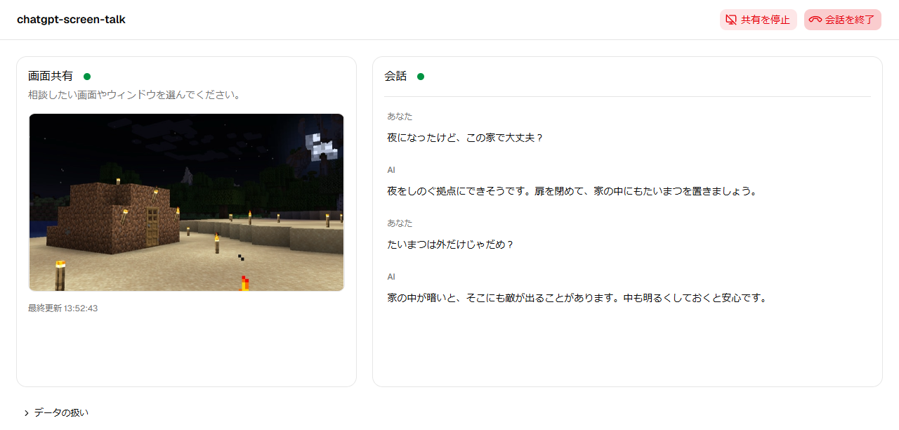

# chatgpt-screen-talk

画面を共有しながら、ChatGPTと音声で相談できるアプリです。お使いのPCで起動し、ブラウザから利用します。

対応OS：Windows

## 主な機能

- 共有した画面について、音声で質問できます。
- 会話の内容を文字でも確認できます。
- 画面共有と音声会話を同じタブで操作し、それぞれ開始・停止できます。

画面のクリックやキー入力を代わりに行う機能はありません。共有したアプリの音声も取得しません。

## 必要な環境

次のものを事前に用意してください。

- [Node.js](https://nodejs.org/en/download) 22.12以降
- [Codex CLI](https://learn.chatgpt.com/docs/enterprise/windows-deployment) `0.164.0-alpha.11.1` と、CodexでのChatGPTログイン
- ChromeまたはEdge

Codexは上記のバージョンに限定しています。[バージョンの確認と導入方法](docs/使い方.md#codexのバージョンが異なる場合)をご確認ください。

このアプリは、CodexにログインしているChatGPTアカウントを使います。OpenAI APIキーへの切り替えは行いません。

## インストール・起動

1. [最新版のZIP](https://github.com/apricot-cake/chatgpt-screen-talk/releases/latest/download/chatgpt-screen-talk-windows.zip)をダウンロードして展開します。
2. 展開したフォルダーの `start.cmd` をダブルクリックします。

Windowsで「発行元を確認できませんでした」と表示された場合は、[起動できない場合](docs/使い方.md#起動できない場合)をご確認ください。

初回は、動作に必要なファイルをダウンロードして準備します。準備が終わるとブラウザが開きます。準備済みのファイルは、次回以降も使います。

必要なソフトウェアやログインが不足している場合は、起動時に対処方法を表示します。

起動時に開くターミナル（処理内容が文字で表示されるウィンドウ）は、利用中も開いたままにしてください。アプリを終了するときは、そのウィンドウで `Ctrl+C` を押します。

## 使い方

1. 「画面を共有」を押し、相談したい画面やウィンドウを選びます。
2. 「会話を開始」を押し、ブラウザにマイクの利用を許可します。
3. 共有したアプリに戻り、「今の画面を見て」などと話しかけます。

利用中は、このアプリのタブを開いたままにしてください。画面共有と会話は個別に終了できます。共有を止めても会話は続き、会話を終了しても共有は続きます。

マイクの音声と、回答に使う共有画像はOpenAIへ送信されます。詳しくは[データの扱い](docs/使い方.md#データの扱い)をご確認ください。

## 利用上の注意

音声機能には、Codex App Serverの試験的な機能を使っています。Codexのバージョンやアカウント、サービスの提供状況によっては利用できない場合があります。[確認状況と制限](docs/使い方.md#確認状況と制限)もご確認ください。

## ドキュメント・問い合わせ

- [使い方・設定・データの扱い](docs/使い方.md)
- [開発ガイド](docs/CONTRIBUTING.md)

質問や不具合の報告、改善の提案は[GitHub Issues](https://github.com/apricot-cake/chatgpt-screen-talk/issues)へお寄せください。コードの変更を提案する場合は、プルリクエストを作成してください。

## ライセンス

[MIT License](LICENSE)で公開しています。

ゲーム画像の権利は各権利者に帰属します。
